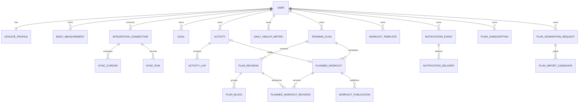

# Running Coach — Database Design v0.2

# Running Coach — Database Design

**Version:** 0.1 (draft)
**Date:** 2026-10-27
**Project:** [Running Coach](https://linear.app/fr-running-coach/project/running-coach-2730d3d0f69a)
**Related:** [PRD v0.4](https://linear.app/fr-running-coach/document/running-coach-product-requirements-prd-v04-a336516f50b0) · [System Architecture v0.1](https://linear.app/fr-running-coach/document/running-coach-system-architecture-v01-5856fc20bd24)

> **Purpose:** logical database design and implementation invariants for private **multi-user** training planning and analysis. Table names/columns are design proposals, not deployed migrations. Final Prisma models and indexes are a separate implementation artifact.

## 1. Database strategy

- **Database:** Neon managed PostgreSQL, with Prisma as ORM.
- **Tenant model:** one database/schema; each athlete owns an isolated set of records. Use internal `userId` on personal root entities, strict authorization everywhere. No separate PostgreSQL database per athlete.
- **Relational fields first** for ownership, time, distance, workout linkages, statuses and metrics used by filters/aggregations. Use **JSONB** for versioned workout step trees, AI contract payloads, variable goal attributes and layouts.
- **Source-aware imports:** every externally sourced record carries provider and origin metadata; never assume external IDs are globally unique.
- **Immutability where history matters:** approved plan revisions, imported activity provenance and previous workout definitions are auditable.
- **Human privacy:** health and GPS records private. Admin capability never implicitly permits reading athlete data.
- **Never store API keys in plaintext.** Credentials use authenticated encryption and a secret managed outside the database.
- **Time handling:** timestamps as `timestamptz` in UTC; plan sessions use a local `date` plus IANA timezone (e.g. Asia/Tokyo), not UTC midnight.
- **Unit handling:** distances in meters, durations in milliseconds, heart rate in bpm, weight in kg, elevation gain in meters. Ingestion and display converters are explicit. Some devices measure with higher precision; retain raw provider representations if necessary.

## 2. Relationship overview



**Design invariant:** a referenced resource must belong to the **same user** as its parent. Enforce ownership in server services and, where practical, via composite foreign keys such as `(user_id, training_plan_id) -> training_plans(user_id, id)`; simply filtering a top-level query is not enough.

## 3. Auth, profile and settings (P0)

### `users`

| Column                     | Type / intent                                                |
| -------------------------- | ------------------------------------------------------------ |
| `id`                       | UUID, primary key (internal identity)                        |
| `auth_subject`             | text, unique: stable verified ID from Clerk/Auth.js provider |
| `email`                    | text nullable, informational (provider may update it)        |
| `role`                     | USER / ADMIN                                                 |
| `status`                   | ACTIVE / SUSPENDED / DELETING                                |
| `created_at`, `updated_at` | timestamptz                                                  |

Do not use email as the ownership key; email can change. Social/shared accounts are out of scope.

### `athlete_profiles`

One-to-one with `users`; `user_id` is the primary key and foreign key.

Optional demographic/training fields: `display_name`, `birth_date` (or age estimate; choose one in implementation), `sex` (optional/private, with values defined separately), `height_cm`, `experience_level`, `preferred_timezone`, `distance_unit`, `weight_unit`, `default_training_days_per_week`, `default_available_weekdays` (small array/JSON), `updated_at`.

- Missing personal data must not prevent planning.
- Do not export birth date or sex to AI unless explicitly selected.
- User may override **training days/week and exact weekdays in each plan**; defaults are only convenience.

### `body_measurements`

`id`, `user_id`, `measured_at`, `measurement_type` (e.g. WEIGHT, HEIGHT), `value`, `unit`, `source`, `source_external_id` nullable.

- Weight must be a history rather than overwriting one number.
- Current displayed weight is latest eligible valid measurement.
- Keep source and timestamp so manual vs Garmin imports can be reconciled.

## 4. External providers and synchronization (P0)

### `integration_connections`

`id`, `user_id`, `provider` (GARMIN/INTERVALS/...), `external_account_id` nullable, `auth_method` (OAUTH/API_KEY/FILE), `status`, `granted_scopes`, `credentials_expires_at`, `last_success_at`, `last_failure_at`, `created_at`, `updated_at`.

**Credentials:** use a separate `integration_credentials` table (1:1 connection) with `ciphertext`, `nonce/iv`, `auth_tag` where required, `encryption_key_version`, `rotated_at`. The encryption master key belongs to the server's secret manager/environment. Credential rows are never returned in normal list/detail queries.

Indexes:

- `index(user_id, provider, status)`.
- Unique connection identity scoped to user + provider + external account as supported by the provider; if account ID is initially unknown, ensure sensible uniqueness on pending connections.

### `sync_cursors`

`id`, `connection_id`, `data_type` (ACTIVITIES/HEALTH/...), `cursor_or_checkpoint` JSONB, `last_synced_at`, `updated_at`.

Unique `(connection_id, data_type)`. Preserve cursor only after a successful checkpoint.

### `sync_runs`

`id`, `user_id`, `connection_id`, `job_type`, `status`, `started_at`, `finished_at`, `records_seen`, `records_written`, `retry_count`, `checkpoint_summary`, `error_code`, `error_safe_message`.

Indexes on `(connection_id, started_at DESC)` and `(status, started_at)`. No raw tokens or full health data in log records.

### `outbox_jobs`

`id`, `user_id`, `kind`, `entity_id`, `idempotency_key`, `payload` (minimal JSONB), `status` (PENDING/LEASED/SUCCEEDED/FAILED), `attempts`, `next_attempt_at`, `lease_expires_at`, `last_safe_error`, `created_at`, `updated_at`.

- Unique `idempotency_key` where applicable.
- Jobs are claimed atomically with bounded leases and cannot run concurrently for same plan/provider when conflicts exist.
- A timed-out external create operation is checked against remote identity before retry (an idempotency key locally does **not** guarantee remote API idempotency).

## 5. Completed activities and health (P0)

### `activities`

`id`, `user_id`, `source_provider`, `external_activity_id`, `sport_type`, `surface_type` nullable, `started_at` timestamptz, `source_timezone` nullable, `distance_meters`, `elapsed_ms`, `moving_ms`, `avg_hr_bpm`, `max_hr_bpm`, `cadence` nullable, `elevation_gain_meters`, `elevation_loss_meters`, `calories`, `activity_title`, `raw_object_ref` nullable, `external_modified_at`, `imported_at`, `updated_at`.

Constraints:

- Unique `(user_id, source_provider, external_activity_id)` for records with external IDs; manual activities use internal ID and explicit source semantics.
- Index `(user_id, started_at DESC)`.
- Nonnegative measured distances/durations; unknown is NULL, not 0.
- Do not store a single mutable `avg_pace` as canonical if it can be derived from distance/time; derived analytics can be materialized/cached later.
- Prefer `bigint` for millisecond durations and `integer` for normal distance in meters; adapt precision as supported.

### `activity_laps`

`id`, `user_id` (for tenant guards), `activity_id`, `lap_index`, `distance_meters`, `duration_ms`, `avg_hr_bpm`, `avg_speed_mps`, `elevation_change_meters`.

Unique `(activity_id, lap_index)`. Index `(user_id, activity_id)`.

### `activity_source_links` (recommended)

`id`, `user_id`, `canonical_activity_id`, `source_provider`, `source_external_id`, `confidence` / `match_method`, `created_at`.

Allows Garmin and [Intervals.icu](http://Intervals.icu) views of the same run to map to **one canonical completed activity**. Unverified fuzzy matching should be presented for review, not automatically merged.

### `daily_health_metrics`

`id`, `user_id`, `source_provider`, `local_date`, `source_timezone`, `resting_hr_bpm`, `hrv_ms`, `sleep_duration_ms`, `sleep_score`, `steps`, `stress`, `body_battery`, `raw_metadata` JSONB nullable, `updated_at`.

Suggested uniqueness `(user_id, source_provider, local_date)` **if the provider returns a single daily summary**; if Garmin provides multiple subdaily observations of a metric, use a separate observation table rather than overwriting data. A cross-source analytics view selects the configured authoritative provider and never sums duplicates.

**Binary timeseries / GPS / FIT:** potentially large; store as private blobs in object storage and keep references, checksum, size and content type in `activity_assets` (P1 or earlier if needed). Avoid stuffing huge FIT streams into Neon JSONB.

## 6. Goals and races (P0 base; P1 route-specific)

### `goals`

`id`, `user_id`, `goal_type` (PERFORMANCE/COMPLETION/CONSISTENCY/VOLUME/etc), `sport_type`, `title`, `target_distance_meters` nullable, `target_duration_ms` nullable, `target_count` nullable, `measurement_window` nullable, `target_date` nullable, `event_id` nullable, `status`, `priority`, `parameters_json` JSONB, `created_at`, `updated_at`.

- **No hardcoded PB5K/PB10K/PB marathon fields.**
- Semantic validation keyed to `goal_type`; fields may be nullable as a group depending on goal.
- One user can have multiple goals.

### `race_events` (recommended)

`id`, `user_id`, `name`, `event_date`, `sport_type`, `distance_meters`, `surface_type`, `elevation_gain_meters`, `route_id` nullable, `location_name` optional, `metadata_json` optional.

### `personal_records` (P1)

`id`, `user_id`, `distance_meters` nullable for route-based events, `route_id` nullable, `surface_type`, `duration_ms`, `achieved_on`, `activity_id` nullable, `official`, `verification_source`.

- Track PBs by configurable distance or exact route; do not compare dissimilar trail terrain purely by distance.
- May have multiple historical results for a distance; preferred record is a query/derived view, not a single unchangeable row.

### `routes` (P1)

`id`, `user_id`, `name`, `distance_meters`, `elevation_gain_meters`, `surface_type`, `gps_asset_ref` nullable, `metadata_json` (checkpoints/cutoffs, when implemented). Private by default.

## 7. Canonical workouts, plans and immutable versions (P0)

This domain needs care: the app edits future workouts, preserves history and syncs external plans safely.

### `workout_templates`

`id`, `user_id`, `name`, `sport_type`, `definition_json` JSONB, `schema_version`, `created_at`, `updated_at`.

Definitions contain generic ordered `Step | RepeatGroup`, duration (time/distance/manual) and intensity targets. Validate with Zod/JSON Schema **before saving**. Database JSONB `CHECK` for core shape is optional defense; schemaVersion is mandatory.

### `training_plans`

`id`, `user_id`, `goal_id` nullable, `name`, `status` (DRAFT/ACTIVE/PAUSED/COMPLETED/ARCHIVED), `start_date`, `end_date`, `timezone`, `detail_window_weeks` (e.g. 2–4, configurable), `current_revision_id` nullable, `created_at`, `updated_at`.

Index `(user_id, status)`. Plan owner controls linked goal and revisions.

### `plan_revisions` (immutable after approval)

`id`, `user_id`, `plan_id`, `revision_number`, `source` (MANUAL/EXTERNAL_AI_IMPORT), `generation_request_id` nullable, `parent_revision_id` nullable, `macro_plan_json` JSONB, `scope_start_date`, `scope_end_date`, `created_at`, `approved_at`.

- Unique `(plan_id, revision_number)`.
- Updates create another revision; existing approved revisions are immutable and accessible for diff/audit.
- Use optimistic concurrency, e.g. compare `training_plans.current_revision_id` with exported/requested base when approving a new revision.

### `plan_blocks`

`id`, `user_id`, `plan_revision_id`, `position`, `start_date`, `end_date`, `phase_type` / `label`, `target_volume_json` JSONB, `notes`.

A macro block can cover weeks; do not require a full day-by-day workout for every date of a long plan.

### `planned_workouts`

**Stable logical identity across revisions**: `id`, `user_id`, `plan_id`, `stable_key`, `status` (SCHEDULED/COMPLETED/SKIPPED/CANCELLED), `current_workout_revision_id` nullable, `matched_activity_id` nullable, `created_at`, `updated_at`.

Unique `(plan_id, stable_key)`. Physical sessions survive plan regeneration, rescheduling and changes to their step definitions.

### `planned_workout_revisions`

`id`, `user_id`, `planned_workout_id`, `plan_revision_id`, `revision_number`, `scheduled_local_date`, `timezone`, `display_name`, `sport_type`, `definition_json`, `schema_version`, `estimated_distance_meters` nullable, `estimated_duration_ms` nullable, `content_hash`, `created_at`.

- Unique `(planned_workout_id, revision_number)`.
- The **current** planned workout revision points to the approved version; previous revisions remain queryable.
- Do not modify completed historical workouts merely because the AI returned different data for the same logical date.
- Avoid circular-FK insert headaches by creating plan/workout first with nullable `current_revision_id`, then inserting revisions and updating pointers in one transaction.

### `workout_publications`

`id`, `user_id`, `planned_workout_id`, `workout_revision_id`, `integration_connection_id`, `provider`, `remote_event_id` nullable, `published_hash` nullable, `publication_status` (PENDING/PUBLISHING/PUBLISHED/FAILED/CANCELLED), `last_attempt_at`, `published_at`, `last_safe_error`.

- Distinguish "published to [Intervals.icu](http://Intervals.icu)" from "delivered to watch" (unknown without explicit evidence).
- Unique scoped remote IDs where available. Use the **existing** remote event ID to update/reschedule rather than creating another event.
- Publication revision must match a revision of the same logical workout and owner.
- Publication+job coordination may need a single stable provider-mapping row with a revision history or `publication_attempts` if auditing individual retries is required.

## 8. External AI exchange and plan revision control (P0)

### `plan_generation_requests`

`id` (UUID used as `requestId`), `user_id`, `plan_id` nullable, `request_type` (INITIAL/REFRESH), `base_plan_revision_id` nullable, `schema_version`, `context_hash`, `allowed_date_range`, `status`, `created_at`, `expires_at`.

An exported JSON file may contain `requestId`, but ownership is validated by matching the authenticated user against this server-side row. Scope restricts which future workouts AI is allowed to replace.

### `plan_import_candidates`

`id`, `user_id`, `generation_request_id`, `content_hash`, `status` (VALID/INVALID/APPROVED/REJECTED), `validated_plan_json` JSONB nullable, `validation_errors_json` JSONB (safe field paths/messages), `created_at`, `approved_at`.

- File-size and nesting/complexity limits; parse only JSON, never execute code from external content.
- Preserve uploaded source hash to identify duplicates. Raw upload retention should be configurable/short-lived.
- Approval transaction checks `base_plan_revision_id` and `requestId` matches before creating immutable new plan/workout revisions.
- Original approved plan continues to operate when an import is rejected.

### Versioning principle

```text
TrainingPlan(id=P1, currentRevision=R3)
 ├─ PlanRevision R1 [approved, immutable]
 ├─ PlanRevision R2 [approved, immutable]
 └─ PlanRevision R3 [approved, current]
     ├─ PlanBlock(s): week/macro phases
     ├─ PlannedWorkout W1
     │    ├─ WorkoutRevision W1-v1 (old)
     │    └─ WorkoutRevision W1-v2 (current; scheduled date changed)
     └─ PlannedWorkout W2 ... (future window only)
```

**Caveat:** this is a _logical_ example. Implement the schema so plan revision snapshots can be reconstructed exactly, including previous workout sets and deleted/cancelled sessions. Do not infer a historical plan solely from mutable `currentRevision` pointers; store revision membership or explicit snapshot rows.

## 9. Notifications and push (P0)

### `notification_preferences`

`user_id` PK, `push_enabled`, per-category switches, `quiet_hours_json` nullable, `timezone`, `updated_at`.

### `push_subscriptions`

`id`, `user_id`, `endpoint` (treat as sensitive), `endpoint_hash`, `p256dh_encrypted`, `auth_encrypted`, `created_at`, `last_seen_at`, `revoked_at`.

Scope all lookup/deletion by owner; unique endpoint hash with careful handling of browser resubscription. Never expose keys to other users.

### `notification_events`

`id`, `user_id`, `type` (PLAN_REFRESH, NO_UPCOMING_WORKOUTS, INTEGRATION_ERROR), `fingerprint`, `related_entity_id`, `status` (OPEN/DISMISSED/SNOOZED/RESOLVED), `action_url`, `created_at`, `updated_at`, `resolved_at`.

Unique user/type/fingerprint while the same logical event remains unresolved. Dismiss persists across page loads until an objectively new event state occurs.

### `notification_deliveries`

`id`, `user_id`, `notification_event_id`, `subscription_id`, `channel` (WEB_PUSH), `status`, `attempted_at`, `sent_at`, `local_calendar_date`, `safe_error`.

- Enforcement rules: **at most one user-level push campaign per local calendar day** and no repeat for unchanged event fingerprint within 7 days.
- For multiple subscriptions, one campaign can fan out to user's own devices without treating each device delivery as a separate reminder.
- Use a separate notification dispatch lock/dedupe record or unique `(user_id, local_calendar_date)` on a `push_campaigns` table; do not wrongly constrain `notification_deliveries`, since one campaign may deliver to many devices.

## 10. Data separation, uniqueness and indexes

### Ownership invariants

1. Every personal root record owns a `user_id` pointing to `users(id)`.
2. User ID for a request comes from verified auth, never from client-provided fields.
3. Nested associations must share `user_id`: a user's planned workout cannot point to another user's plan, activity, goal or provider connection.
4. All sync, export, import, notifications, publishing and admin routes explicitly enforce these invariants.
5. Never permit direct public file URLs for FIT/GPS exports; use short-lived access controls or authenticated streams.

### Core indexes / constraints

| Entity             | Suggested unique key                                 | Primary access index            |
| ------------------ | ---------------------------------------------------- | ------------------------------- |
| User               | `auth_subject`                                       | `(status)`                      |
| Activity           | `(user_id, source_provider, external_activity_id)`   | `(user_id, started_at DESC)`    |
| Health daily       | `(user_id, source_provider, local_date)`             | `(user_id, local_date DESC)`    |
| Sync cursor        | `(connection_id, data_type)`                         | `(connection_id)`               |
| Plan revision      | `(plan_id, revision_number)`                         | `(user_id, plan_id)`            |
| Planned workout    | `(plan_id, stable_key)`                              | `(user_id, plan_id, status)`    |
| Workout revision   | `(planned_workout_id, revision_number)`              | `(user_id, planned_workout_id)` |
| Publication        | `(user_id, provider, remote_event_id)` when non-null | `(user_id, publication_status)` |
| Outbox job         | `idempotency_key`                                    | `(status, next_attempt_at)`     |
| Notification event | Open event `(user_id, type, fingerprint)`            | `(user_id, status)`             |

**Index notes:** do not over-index every field; verify with real activity history and `EXPLAIN ANALYZE`. For non-null-only and "only open" uniqueness, PostgreSQL partial unique indexes may require raw SQL migration alongside Prisma schema.

## 11. Transactions and concurrency

**Activity import (one page):**

1. Validate/normalize provider data.
2. Upsert activities by per-user/provider external identity.
3. Upsert laps and source links (replace safely if external record changed).
4. Advance cursor **only after** successful data write in the same transaction where feasible.
5. Record summary in SyncRun.

**Plan AI import approval:**

1. Auth check owner, request ownership, schema version, allowed scope and unexpired request.
2. Compare current approved plan revision with `base_plan_revision_id`.
3. In one transaction insert new PlanRevision, blocks and changed future workout revisions; update current plan/workout revision pointers.
4. Create publish/cancel outbox jobs; commit.
5. Process external calls asynchronously with bounded retries; never perform remote API calls inside a long-held DB transaction.

**Delete account:**

- Revoke provider tokens/subscriptions first when possible, mark user as DELETING, stop jobs, delete personal data and private files in an auditable asynchronous workflow. Make partial cleanup recoverable.

## 12. Retention, backups, migration and observability

- MVP data retention policy must be decided: how long to store raw FIT/GPS, unapproved AI imports, notification delivery logs and provider debugging metadata.
- Export all user's data in portable JSON/CSV; apply deletion to backups according to provider capabilities/retention policy.
- Keep production data separate from Vercel preview deployments; never clone real health/location data to a preview branch accessible to collaborators.
- Neon managed backup/PITR availability depends on selected plan and settings; confirm before launch, document restore procedure and periodically test.
- Runtime uses **pooled Neon URL** and Prisma driver configuration appropriate to pinned Prisma major; migration CLI uses **direct** URL. Avoid connection storms and long-lived connections in serverless functions.
- Log metrics: activity import count, sync cursors, publish failures, database query latency, queue backlog, import validation failures. Never log raw health streams, GPS coordinates, credentials or full AI export payloads.

## 13. Implementation phases

**DB milestone A (first deploy):** users, athlete_profiles, integration_connections + encrypted credentials, activities, daily_health_metrics, sync_runs/cursors. Seed admin account through auth identity.

**DB milestone B (planner):** goals, training_plans, plan_revisions, plan_blocks, planned_workouts + revisions, generation_requests/import_candidates.

**DB milestone C (device sync):** workout_publications, outbox_jobs, activity matching/source links. Prove idempotency and cross-user isolation.

**DB milestone D (notification):** preferences, events, push_subscriptions, campaigns/deliveries. Enforce daily and weekly cooldown rules.

**DB milestone E (advanced analysis):** personal_records, routes, dynamic measurements, dashboard layouts, optional raw FIT assets.

## 14. Data-model acceptance criteria

- Two users can create the same external activity ID and plan slug without collisions or data leakage.
- A cross-user reference is rejected, not silently accepted, both at service layer and via feasible DB constraints.
- Plan refresh creates a new immutable plan revision and preserves the old one; finished sessions are not rewritten.
- Rescheduling one future workout updates its stable logical identity and provider publication correctly.
- Repeated Garmin/Intervals import results in one canonical activity for one run.
- A malformed AI file cannot create a plan or trigger an external publication.
- Credentials are decryptable only server-side; secret key is absent from database exports and client responses.
- Notification dedup prevents weekly repeats from becoming daily spam, even with multiple logged-in devices.
- Full user deletion can remove all personal records without deleting other users' data.

## 15. Open DB/implementation decisions

- **DB-001:** UUID vs CUID2 for internal IDs (either fine; consistent policy preferred).
- **DB-002:** final Clerk/Auth.js choice and user provisioning strategy.
- **DB-003:** fitness metrics schema shape: daily summaries vs typed time-series observations for HRV/sleep.
- **DB-004:** which activity source is authoritative where Garmin and Intervals duplicate results.
- **DB-005:** exact snapshot/revision membership semantics for deleted/moved workouts across plan revisions.
- **DB-006:** Neon plan, backup recovery targets, regional deployment and private FIT object storage.
- **DB-007:** RLS strategy given Prisma connection pooling; do not claim isolation solely from RLS until tested.
- **DB-008:** measured numeric precision and handling of multi-day trail/ultra sessions.

## 16. External references

- Neon connection guidance: [https://neon.com/docs/connect/connect-from-any-app](https://neon.com/docs/connect/connect-from-any-app)
- Neon + Prisma runtime/migration connection guidance: [https://github.com/neondatabase/website/blob/main/content/faqs/find-database-url-neon.md](https://github.com/neondatabase/website/blob/main/content/faqs/find-database-url-neon.md)
- [Intervals.icu](http://Intervals.icu) API: [https://www.intervals.icu/features/open-api/](https://www.intervals.icu/features/open-api/)
- Garmin Personal API FAQ: [https://developer.garmin.com/gc-developer-program/personal/personal-faq/](https://developer.garmin.com/gc-developer-program/personal/personal-faq/)
- Vercel Cron: [https://vercel.com/docs/cron-jobs/usage-and-pricing](https://vercel.com/docs/cron-jobs/usage-and-pricing)
- Clerk restricted sign-up: [https://clerk.com/docs/guides/secure/restricting-access](https://clerk.com/docs/guides/secure/restricting-access)

## 17. Invitations: admin-only access control (confirmed)

**Role model:** `users.role` is `USER | ADMIN`. An invitation can only be issued, listed, resent, or revoked by a verified `ADMIN` at the server/service authorization layer. Invited users always start with `USER` role. Role changes require a privileged administrative procedure; never trust client-supplied role values.

**Invitation persistence:** Prefer provider-managed invites if using Clerk and it exposes all required lifecycle operations; do not create unnecessary duplicate local invite tables. If custom invites are needed, add:

`invitations`:

- `id` UUID PK
- `email_normalized` text
- `token_hash` text unique (**store hash**, not plaintext bearer token)
- `status` PENDING | ACCEPTED | EXPIRED | REVOKED
- `invited_by_user_id` FK -> [users.id](http://users.id) (issuer must have been ADMIN at issuance)
- `expires_at`, `created_at`, `accepted_at`, `revoked_at`
- `accepted_by_user_id` nullable FK -> [users.id](http://users.id)
- Optional `provider_invitation_id` for externally managed invitations

Use atomic single-use acceptance, expiry validation, invite-email/verified-email matching as supported, rate limiting, auditing, and safe public error messages. Unique indexes should prevent unintended concurrent active invites for one email where appropriate. Bootstrap the initial admin through trusted provider/deployment configuration, not a public registration flow.

**Tests:** ordinary USER and unauthenticated requests cannot list/create/revoke/resend invites; accepted/expired/revoked tokens cannot register another user; signup never grants ADMIN; admin status does not bypass other users' data-ownership checks.
