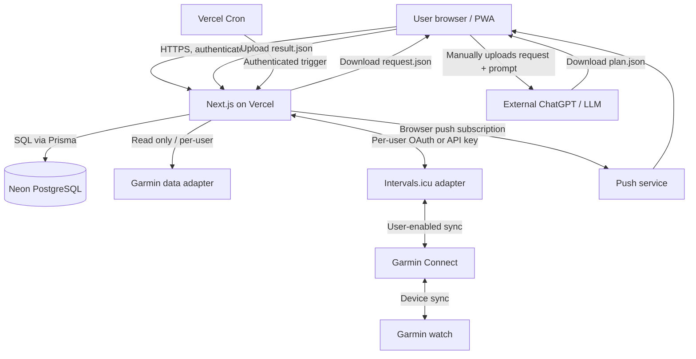

# Running Coach — System Architecture v0.2

# Running Coach — System Architecture

**Version:** 0.1 (draft)
**Date:** 2026-10-27
**Project:** [Running Coach](https://linear.app/fr-running-coach/project/running-coach-2730d3d0f69a)
**Product source of truth:** [PRD v0.4](https://linear.app/fr-running-coach/document/running-coach-product-requirements-prd-v04-a336516f50b0)

> **Scope:** architectural design for a small, private, invite-only multi-user web app (initially the owner and friends) that can grow without a rewrite. This document makes explicit **recommendations**, **decisions**, and **unverified integration assumptions**; it is not a claim that every external API path has been tested.

## 1. Architecture decisions

| Area                     | MVP decision / recommendation                                                                                         | Rationale                                                           |
| ------------------------ | --------------------------------------------------------------------------------------------------------------------- | ------------------------------------------------------------------- |
| Hosting                  | Vercel                                                                                                                | Minimal operations, deploy preview support                          |
| Application              | Single Next.js TypeScript app (App Router, server-only modules, Route Handlers/Server Actions)                        | No need for a separate NestJS service initially                     |
| Persistence              | Neon managed PostgreSQL                                                                                               | Transactions, relational integrity, managed operations              |
| ORM                      | Prisma, version pinned at implementation                                                                              | Typed data access/migrations                                        |
| Authentication           | **Clerk, preferred; final choice pending**                                                                            | Ready-made invite-only sign-up and session flows                    |
| Authorization            | Server-side owner checks for every personal resource                                                                  | Multi-user isolation is an MVP requirement                          |
| Integration architecture | Provider adapters, per-user connections                                                                               | No vendor-specific assumptions in business logic                    |
| Outgoing training plans  | [Intervals.icu](http://Intervals.icu) REST/OAuth where available                                                      | Creates calendar workouts; delegates device sync to linked provider |
| Completed activities     | Provider-neutral import, Garmin where permitted, [Intervals.icu](http://Intervals.icu) and manual import as fallbacks | Garmin Personal API multi-user terms remain a risk                  |
| AI                       | Versioned JSON request/response **through external chat**                                                             | No paid built-in LLM API for MVP                                    |
| Background processing    | Daily Vercel Cron dispatcher + bounded/resumable jobs; manual sync                                                    | Vercel Hobby scheduling is once per day, not a persistent worker    |
| Notifications            | Persistent in-app notices + opt-in Web Push/PWA                                                                       | Infrequent, actionable reminders                                    |
| Object storage           | Optional private blob/object store only if storing full FIT/routes is needed                                          | Avoid large binaries in PostgreSQL                                  |

**Explicitly out of MVP:** Kafka, Redis, always-on workers, social/community, subscription billing, native mobile clients, autonomous AI plan publishing.

## 2. Context and trust boundaries



Trust boundaries:

- Browser is untrusted. Client-supplied userId, ownership, plan status or external provider IDs are not authority.
- External JSON from LLMs, Garmin, [Intervals.icu](http://Intervals.icu) and browser file uploads is untrusted input; validate and normalize.
- Garmin credentials and Intervals tokens remain server-side, encrypted at rest.
- The external chat must **never** receive access tokens, API keys, full private route data by default, or any other user's data.
- Admin controls invitations and system health but does **not** automatically gain access to another athlete's health/activity records.

## 3. Application modules

Organize by business domains within one repository (avoid a giant shared `services.ts`):

```text
src/
  app/
    (auth)/                         # sign-in / invite acceptance
    (app)/                          # dashboard, activities, calendar, goals, settings
    api/
      integrations/                 # connection and status endpoints
      sync/                         # manually-triggered bounded sync
      plans/                        # goal, plan, versions, import/export
      workouts/                     # builder, previews, publishing
      notifications/                # subscriptions, dismiss/snooze
      cron/daily/                   # protected scheduled dispatcher
  server/
    auth/                           # verified session -> internal user
    db/                             # Prisma client, transactions
    authorization/                  # owner / admin capabilities
    athlete/                        # profile and measurements
    activities/                     # canonical imports, laps, dedup
    metrics/                        # health/day and analytics
    goals/                          # distance-independent goals
    plans/                          # macro / detail windows, revisions
    workouts/                       # universal workout schema and validation
    integrations/
      adapters/                     # Garmin, Intervals.icu, manual imports
      secrets/                      # encrypt/decrypt, rotate, revoke
    files/                          # AI exchange import/export
    jobs/                           # leases, retries, checkpoints
    notifications/                  # push, event lifecycle, cooldown
  schemas/                          # shared Zod schemas, versioned
  components/
  lib/
prisma/
  schema.prisma
  migrations/
docs/
```

**Boundary rule:** route handlers authenticate and authorize, call domain services; domain services own transactions, invariant checks, provider orchestration, and error mapping. React components never directly call third-party services with credentials.

## 4. Authentication & user lifecycle

**Recommended starting point: Clerk Invite-only**; evaluate pricing/limits before implementation. Clerk can restrict sign-up to invitations. Alternatives: Auth.js with a custom invite implementation.

Lifecycle:

1. Admin issues single-use or expiring invitation through the auth provider (avoid inventing a second invitation system if provider handles it).
2. User signs up, verifies contact as required, and receives an internal `User` row keyed by the verified external auth subject.
3. User completes optional Athlete Profile; chooses units, timezone, default weekly training availability.
4. User explicitly connects each external provider.
5. Account deletion disconnects integrations, revokes subscriptions, schedules tenant-data removal, and provides data export.

Authorization:

- Resolve the current `userId` **server-side** on each request.
- Read/write queries are filtered by ownership and nested relations are ownership-checked.
- Admin role is only for invites/app operations. Any future coach sharing requires explicit consent and a separate permission model.
- Verify against IDOR, cross-user file import, direct-link read, sync execution as another user, notification subscription takeover, and external publication.

Optional defense in depth: PostgreSQL RLS, **only after** verifying request-scoped tenant context with Prisma and Neon pooled connections. Do not assert RLS is active unless integration tests prove it; app authorization remains mandatory.

## 5. Integration adapters

Define provider-neutral interfaces (illustrative; contract refined after PoC):

```ts
interface ActivitySource {
  listActivities(userConnectionId: string, cursor?: string): Promise<ActivityPage>
  fetchActivityDetail(connectionId: string, externalId: string): Promise<CanonicalActivity>
  listDailyMetrics?(connectionId: string, range: DateRange): Promise<DailyMetric[]>
}
interface WorkoutPublisher {
  create(connectionId: string, event: PublishableWorkout): Promise<RemoteEvent>
  update(connectionId: string, remoteId: string, event: PublishableWorkout): Promise<RemoteEvent>
  remove(connectionId: string, remoteId: string): Promise<void>
}
```

### Garmin

- Personal API: self-generated key exchanges for a 24-hour-or-less access token; no refresh token. Key expiration/revocation requires reconnect.
- Personal API is designed for individual access to one's own data; multi-user server-side use **must be checked against current Garmin terms** before enabling that connection for friends. A noncommercial audience is not by itself a permission grant.
- App operation must not depend on Garmin direct API; manual import and/or supported [Intervals.icu](http://Intervals.icu) data read are alternatives.
- No direct outbound workout publishing through Personal API.

### [Intervals.icu](http://Intervals.icu)

- REST API provides planned calendar workouts, activities, wellness data and OAuth 2.0 or API-key auth; prefer consent-based OAuth for users if registration/scopes are feasible.
- The user separately connects [Intervals.icu](http://Intervals.icu) to Garmin Connect and enables **Upload planned workouts**.
- The device only receives upcoming workouts according to [Intervals.icu](http://Intervals.icu)'s moving publication window (typically roughly 7 days). Running Coach should not claim a workout has _arrived on watch_ merely because the API request succeeded.
- Track local published hash, remote event ID and sync status. Never automatically republish/recreate on every page visit.
- Test step compatibility end-to-end on Forerunner 165 (repeats, pace, HR zone, manual-lap steps, rescheduling, cancellation).

### Data provenance and avoiding double counts

- Every activity/metric records source/provider + external ID.
- Garmin → [Intervals.icu](http://Intervals.icu) can result in the **same completed activity appearing in two providers**. Default to one authoritative primary source per user and deduplicate/cross-link duplicates (do not blindly sum).
- Provider adapters produce canonical domain objects. Full provider payloads, if retained, are separated from canonical records.

## 6. Training data & two-level plans

**Canonical workout definition:** `Workout -> Step | RepeatGroup -> Termination + Target`, versioned and validated independently of any provider format.

- **Macro plan**: total preparation time, phases/blocks, weekly targets, goals and assumptions, unconstrained by fixed race distances.
- **Rolling detail plan**: structured workouts for the next **2–4 weeks** (user configurable).
- Changes to a plan create a **new immutable revision**. The current approved revision is selected explicitly.
- Past completed workouts/activities are never overwritten when importing AI-generated changes.
- Stable logical planned-workout IDs permit comparison across plan revisions. Each published workout points to the exact workout revision used.

### Three-step first-plan wizard

1. **Goal & Constraints** — sport/surface, any distance, goal type/time, race date, training days/week, specific days, maximum session time, optional athlete context, restrictions, whether to include sensitive metrics.
2. **Generate in external chat** — download `training-plan-request.json`, copy a ready prompt, upload the returned `training-plan.json`; precise parse/schema/business errors + **Copy Fix Prompt**. Never treat AI text or JSON as executable instructions.
3. **Review & Publish** — preview macro phases and detail sessions, warnings and availability conflicts, explicit approval; save then publish supported future workouts via [Intervals.icu](http://Intervals.icu).

### Rolling refresh wizard

- Evaluate completion, recent training metrics and remaining coverage.
- Export updated request with current approved plan and fixed/locked history.
- Import same versioned response format; show diff for changed future workouts; save a new revision only after approval.

### JSON exchange boundary

- `schemaVersion`, unique `requestId`, `goal`, `constraints`, `athleteContext` (minimized), `planScope`, `outputContract` and readable instructions.
- Response includes `schemaVersion`, matching `requestId`, `macroPlan`, `detailWindow`, stable workout IDs and stated assumptions.
- Server stores issued request (ownership, revision/snapshot/hash, allowed scope). A correctly formatted `requestId` does **not** authorize access or changes to another user.
- Validation pipeline: file size/type → parse JSON → schema → semantic/date/unit rules → workload warnings → compatibility with exporter → preview/diff → approval + transaction.
- Version migrations for older JSON contracts must be explicit; reject unsupported schema versions with actionable error.
- Correction prompt based on typed issue paths; include errors and schema hints, never sensitive credentials or unrelated users' details.

## 7. Publication, consistency and jobs

**Avoid distributed transactions with external providers.** Save local intent and publish through a retryable job.

Suggested workflow:

1. In a DB transaction, save approved plan revision, planned workout revisions and an **OutboxJob** per publication/change/cancellation.
2. Dispatcher claims pending jobs with a DB lease/expiry and user/provider scoped concurrency guard.
3. Convert canonical workout to provider format, validate compatibility, send remote request.
4. Persist remote ID, last-published content hash and resulting state.
5. On timeout, check remote status before retrying to avoid remote duplicates.
6. Mark distinct states: `draft/scheduled/publishing/published/failed`; device delivery remains `unverified` unless confirmed.
7. Import completed activities separately and attempt owned plan↔activity matching with user confirmation on ambiguity.

Cron:

- On **Vercel Hobby**, cron is limited to once per day, with non-exact timing within the scheduled hour. Manual Sync Now should work independently.
- Daily job dispatches bounded per-user sync, reminder evaluation and outbox processing; if limits prevent completion, persist cursors and resume on next run/manual action.
- Manual sync must be rate-limited and concurrency-controlled to prevent overlapping jobs.
- For eventual growth or faster delivery, move heavy jobs to a managed queue/worker without changing domain services.

## 8. Notifications and PWA

- Persist **notification events** and their state `open/dismissed/snoozed/resolved`; dashboard banner remains visible across refresh until explicitly dismissed or condition resolved.
- Web Push is **opt-in** and uses VAPID + service worker; subscription is owned by a user and device, revocable.
- One push maximum per user per calendar day and typically no more than one reminder for the **same unresolved reason** in seven days; store dedupe fingerprint and last delivery time.
- Trigger on action needed: end of detailed window, no future workout, persistent sync failure; never push on every Garmin sync.
- Deep link goes to the exact next step (Plan Refresh Wizard or Integration Recovery).
- Browser-background delivery varies by OS/browser; no guarantee of delivery while device is off.

## 9. Infrastructure and deployments

- Runtime: Vercel Node.js functions for server-side Prisma/API calls.
- PostgreSQL via Neon: **pooled** runtime URL and **direct** migrations URL. Specific Prisma configuration differs by Prisma major version; pin the version and document the matching adapter/config.
- Use distinct development and production databases/branches; optional isolated Neon branches for previews. Never copy real friends' health records into public or shared previews.
- DB migrations run in a controlled CI/deployment step, not on every request; no destructive automatic schema push.
- Object storage only for private raw FIT files/routes if needed; no persistent local filesystem assumptions inside Vercel Functions.
- Standard HTTPS, CSP/secure cookies where applicable, server-side encryption for integration tokens with a separate secret key, logs with sensitive-data redaction.
- Capture operational telemetry: sync success/failure, API response codes, job lag, publish retries, plan validation failures **without** logging detailed health records or secrets.

## 10. Failure handling

| Failure                                           | Required behavior                                                                      |
| ------------------------------------------------- | -------------------------------------------------------------------------------------- |
| Garmin credentials expired                        | Show per-user reconnect UI; keep data and manual planning functional                   |
| [Intervals.icu](http://Intervals.icu) unavailable | Save plan and local publication intent; retry later without duplication                |
| Returned AI JSON invalid                          | Report precise path / expected values; copy safe repair prompt; preserve existing plan |
| Chat-generated plan too aggressive                | Show warnings and require human approval; do not imply medical clearance               |
| External activity duplicated                      | Detect by provider ID / cross-provider match; do not double-count                      |
| Concurrent plan update                            | Version / optimistic-lock conflict; request user review instead of silent overwrite    |
| Cron over time budget                             | Save checkpoint, release lease, continue later                                         |
| Push permission denied                            | Continue in-app reminders without interrupting plan creation                           |
| Owner tries another user's ID                     | Deny access and log non-sensitive authorization failure                                |

## 11. Testing and acceptance gates

**P0 architectural tests:**

1. Two users cannot list, read, mutate, sync or export each other's activities, goals, plans, tokens or notifications (including through guessed IDs).
2. A workout with repeats and pace targets survives canonical JSON roundtrip and the real [Intervals.icu](http://Intervals.icu) → Garmin Forerunner 165 path (PoC).
3. A second sync/publish does not create duplicate activities or remote events.
4. Garmin/Intervals downtime does not delete locally saved approved plans.
5. Revised 2–4-week window updates only allowed future sessions; old completed sessions and plan revisions remain auditable.
6. Rejected JSON offers actionable field errors and a repair prompt.
7. A push opt-out is honored and weekly cooldown prevents spam.
8. Production migration/restore and single-user data deletion are exercised on test tenants.

## 12. Open technical decisions / ADR backlog

- **ADR-001:** Clerk vs Auth.js; estimate pricing, complexity and invite UX. Preference: Clerk unless costs/requirements say otherwise.
- **ADR-002:** Garmin Personal API usage in small shared apps; get clarity before enabling for multiple accounts.
- **ADR-003:** Garmin vs [Intervals.icu](http://Intervals.icu) vs manual import precedence; establish exact supported health metrics.
- **ADR-004:** JSON Schema v1, canonical Workout schema, provider mapping, units and version upgrade strategy.
- **ADR-005:** Neon/Prisma major version, pooled runtime driver, migrations and RLS strategy.
- **ADR-006:** Raw FIT / GPS retention policy and whether private object storage is required in MVP.
- **ADR-007:** Background processing approach if Vercel daily cron plus manual sync proves insufficient.

## 13. Sources & external documentation

- Garmin Personal API: [https://developer.garmin.com/gc-developer-program/personal/personal-faq/](https://developer.garmin.com/gc-developer-program/personal/personal-faq/)
- Garmin Personal API reference: [https://developer.garmin.com/gc-developer-program/personal/swagger-docs/](https://developer.garmin.com/gc-developer-program/personal/swagger-docs/)
- [Intervals.icu](http://Intervals.icu) API: [https://www.intervals.icu/features/open-api/](https://www.intervals.icu/features/open-api/)
- [Intervals.icu](http://Intervals.icu) → Garmin planned workouts: [https://forum.intervals.icu/t/upload-planned-workouts-to-garmin-connect/1521](https://forum.intervals.icu/t/upload-planned-workouts-to-garmin-connect/1521)
- Vercel Cron limits: [https://vercel.com/docs/cron-jobs/usage-and-pricing](https://vercel.com/docs/cron-jobs/usage-and-pricing)
- Neon database connectivity: [https://neon.com/docs/connect/connect-from-any-app](https://neon.com/docs/connect/connect-from-any-app)
- Clerk invite-only: [https://clerk.com/docs/guides/secure/restricting-access](https://clerk.com/docs/guides/secure/restricting-access)

## 14. ADR-008: Administrator-only invitations (confirmed)

**Decision:** invite-only is governed exclusively by the `ADMIN` role; ordinary users may not invite other users. Even invite-management read endpoints are administrative.

- Enforce server-side authorization with a trusted authenticated subject resolved to internal `User`, then `role === ADMIN`; UI visibility is convenience only.
- Prefer the chosen identity provider's restricted sign-up/invitation facilities if they support single-use/expiry/revocation. Create invitations through an admin-authorized server action or Route Handler; never expose privileged provider API credentials to the browser.
- New accounts created from a valid invitation become `USER` by default; no signup setting may request `ADMIN`.
- First admin must be bootstrapped securely using an explicit deployment/provider administrative procedure; do not implement a public 'become admin' endpoint.
- Invitation state and audit trail: who invited whom, created time, expiration, acceptance, revocation. If invitations are fully provider-managed, maintain only an optional local audit reference rather than duplicating provider state.
- Test unauthorized access to all invite endpoints; enforce email and invitation state validation at acceptance and avoid account enumeration.
- This decision does not alter the tenant privacy boundary: ADMIN is **not** an automatic cross-user health-data reader.
